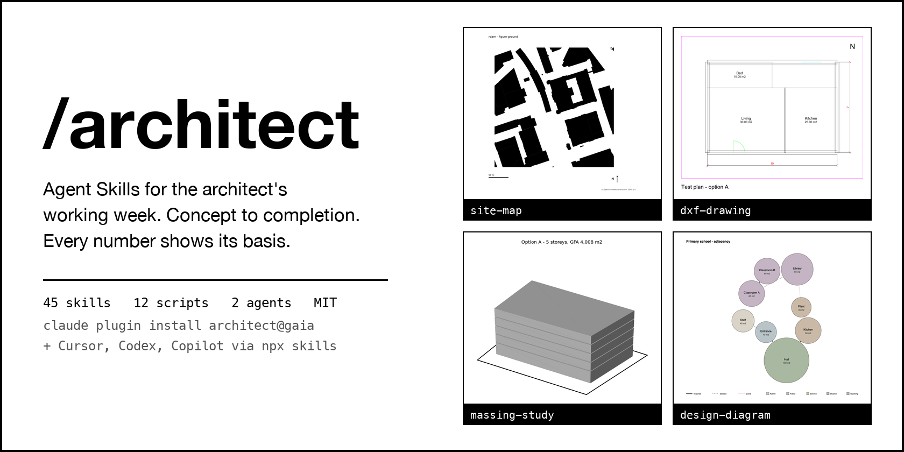
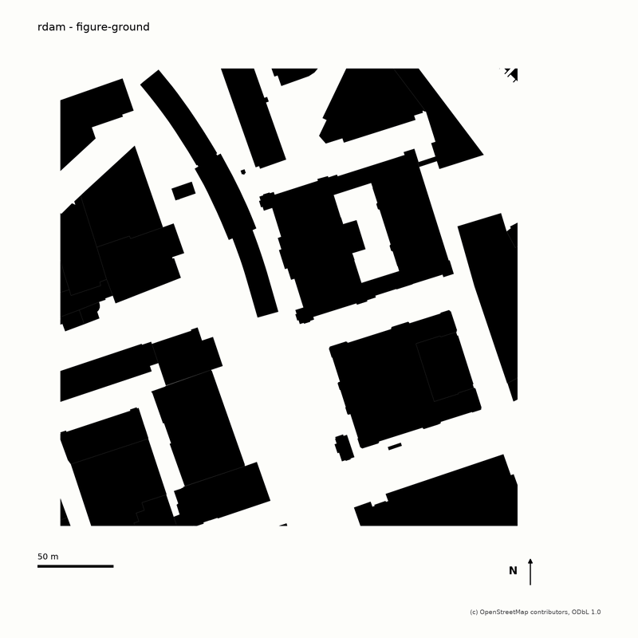
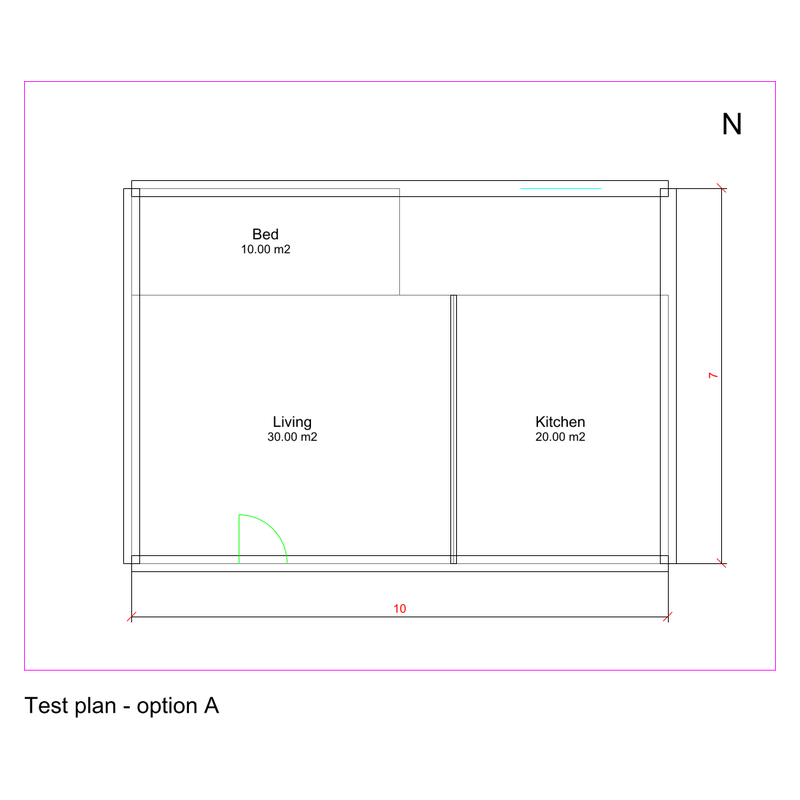
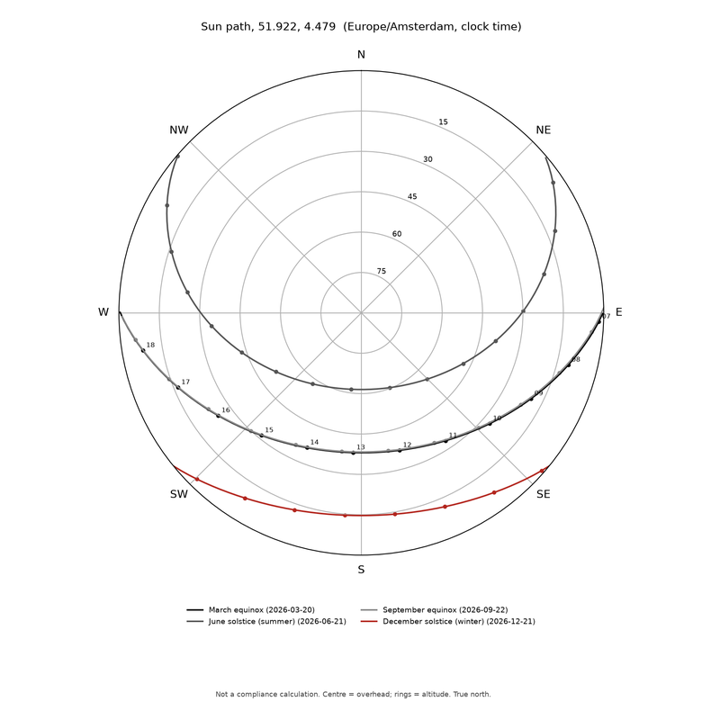
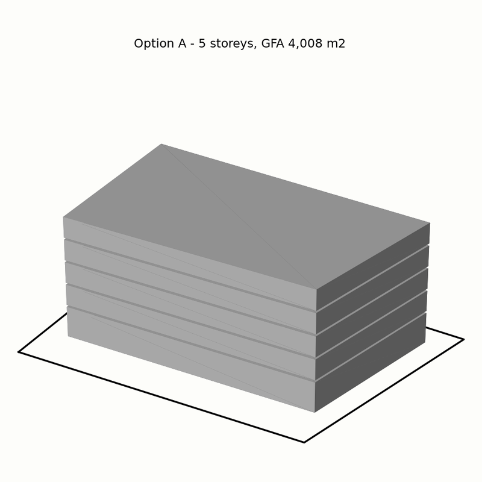
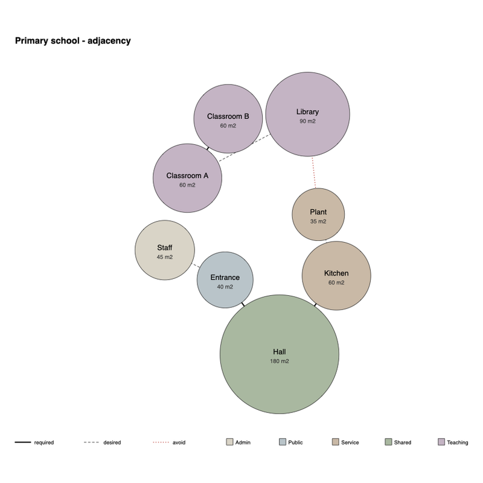
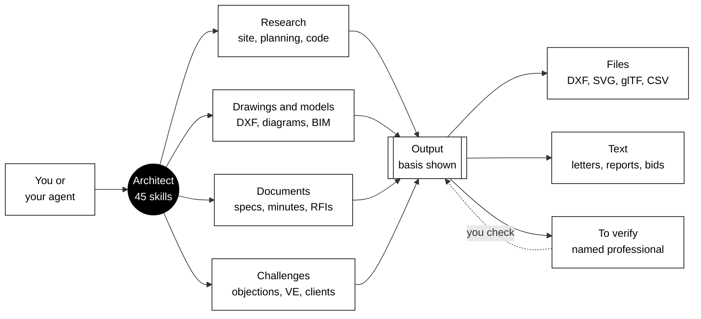
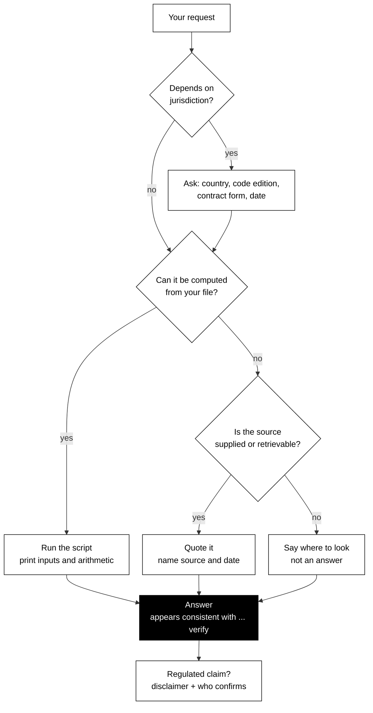
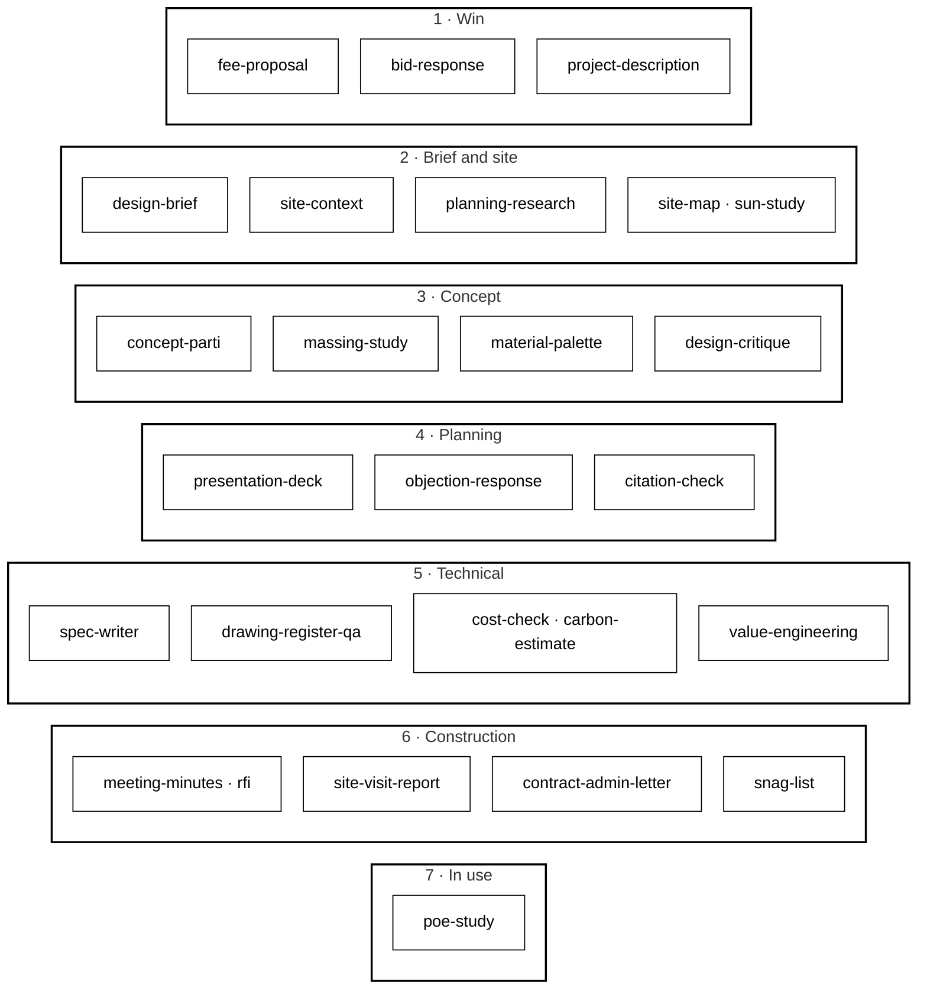
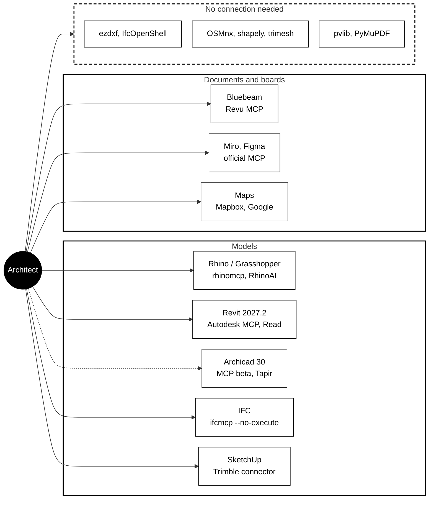

<div align="center">



<br/><br/>

# Architect: open-source Agent Skills for architects

The colleague who writes the brief, reads the site, draws the diagram, checks the drawing set, chases the RFIs and answers the objection, and tells you plainly what it cannot know.

**From your coding agent:** install it ([one line per agent](#start-in-30-seconds)), then say "Hey Claude, turn these meeting notes into minutes and an action log."

<!-- skill-count:45 -->
**45** skills · **12** tested scripts · **2** agents · **8** tool connectors · **70+** agents supported · **MIT**

<br/>

[](https://skills.sh/gaia-computer-technologies/architect)
[](https://github.com/gaia-computer-technologies/architect/stargazers)


[](https://github.com/gaia-computer-technologies/architect/actions/workflows/validate.yml)

<br/>


<sub>Real runs of the skills' own scripts, with the OpenStreetMap fetch cached beforehand. Re-record it: <code>vhs assets/tapes/demo.tape</code></sub>

<br/><br/>

| `site-map`, Rotterdam from OpenStreetMap | `dxf-drawing`, a layered DXF with real dimensions | `sun-study`, solstices and equinoxes |
|---|---|---|
|  |  |  |
| **`massing-study`**, feasibility yield from setbacks and height | **`design-diagram`**, adjacency sized by area | |
|  |  | Every image here was made by the skills' own scripts, from code alone, with no CAD licence. Each script prints the inputs and arithmetic behind its numbers. |

</div>

---

## What it is

Architect is a set of 45 [Agent Skills](https://agentskills.io) for the work architects actually do in a week: briefs and site reads, planning research and code navigation, drawings and models, specifications, cost and carbon, minutes and RFIs, site reports and contract letters, bids and fee proposals, and the hard conversations with clients, objectors and quantity surveyors.

It is built on one rule, taken from what architects say goes wrong with AI: **discipline the model, don't just prompt it.** A wrong answer stated confidently is worse than a gap that is flagged.

It drafts, computes and checks. It does not certify, sign off, or replace a qualified professional, and it says so in the output whenever that matters.

## Start in 30 seconds

| Where you work | Run this |
|---|---|
| Claude Code, plugin (skills, agents, guardrail hook) | `claude plugin marketplace add gaia-computer-technologies/architect`, then `claude plugin install architect@gaia` |
| Cursor, Codex, GitHub Copilot, Gemini CLI, Windsurf and about 70 more | `npx skills add gaia-computer-technologies/architect` |
| Claude Desktop, claude.ai, Cowork | Customize → Plugins → add marketplace from GitHub → `gaia-computer-technologies/architect` |
| Only a few skills | `npx skills add gaia-computer-technologies/architect --skill meeting-minutes --skill rfi` |

Then ask in plain words ("draft the RFI log from these emails", "make a figure-ground for this address", "check this drawing set against the register"), or open the menu with `/architect:architect` (plugin) or `/architect` (skills install).

<details>
<summary><b>Upgrading from <code>concept-design@gaia-ai-architect</code></b></summary>

The plugin is now `architect` in the `gaia` marketplace, and commands moved from `/concept-design:<skill>` to `/architect:<skill>`.

```bash
claude plugin marketplace remove gaia-ai-architect
claude plugin marketplace add gaia-computer-technologies/architect
claude plugin install architect@gaia
```

</details>

## What it does



## How a skill answers

Every skill follows the same discipline. This is the part that makes it safe to use on real projects:



- **Show the basis of every number.** Measured, convention, or judgement, and which.
- **Never fabricate** a precedent, appeal decision, code clause, product, benchmark, person or project.
- **"Appears consistent with ... (verify)"**, never "complies". No structural, fire, accessibility, code or contractual rulings.
- **No home country.** RIBA, AIA and HOAI stages; JCT, NEC, AIA, FIDIC and local contracts; NBS, MasterFormat and NATSPEC.
- **Safe writes.** Model connectors default to read-only and show a dry run before any edit.

<details>
<summary><b>Advanced: a whole project</b>, which skills come in at which stage</summary>



The **project-architect** agent runs this arc and chains skills where the work chains: an objection letter goes through `citation-check` before `objection-response`; a VE request goes to `cost-check` and `carbon-estimate` before `value-engineering`. The **concept-architect** agent runs the concept stage.

</details>

<details>
<summary><b>Advanced: connect your tools</b>, BIM, CAD and boards over MCP</summary>

Skills work on their own and get sharper with your software connected. `/architect:tool-setup` checks what is connected and walks through the rest. Solid lines are recommended routes; the dashed line is a beta route behind a paid tier; the dashed box needs no connection at all.



| Software | Route | Watch out for |
|---|---|---|
| Rhino / Grasshopper | McNeel RhinoAI (official) or rhinomcp | Official is young; check document units first |
| Revit | Autodesk Revit Public MCP (Revit 2027.2) | Use the Read server; Write is preview |
| Archicad | Archicad 30 MCP (beta) or Tapir MCP | Official needs a Collaborate or Max subscription |
| SketchUp | Trimble SketchUp connector | Needs a Trimble ID |
| IFC / openBIM | IfcOpenShell `ifcmcp` | Run with `--no-execute` |
| Bluebeam | Revu MCP | Revu 21.9+, Max plan |
| Miro, Figma | Official MCP servers | Read-only by default on client boards |
| Maps | Mapbox MCP, Google Maps Grounding Lite | Or OpenStreetMap from code via `site-map` |

As of November 2026. Tool detail dates fast, so each connector skill keeps its own dated `references/tool-notes.md`.

</details>

## The 45 skills

Commands are in plugin form; drop the `architect:` prefix after an `npx skills` install. **Script** means the skill ships tested Python that computes the result from your files (`uv run` installs its dependencies). **Flagged** means outputs that state a regulated fact end with a verification disclaimer.

| | Skill | What it does | |
|---|---|---|---|
| **Start** | [`architect`](skills/architect/SKILL.md) | The menu: routes any task to the right skill | |
| **Concept** | [`design-brief`](skills/design-brief/SKILL.md) | A structured brief from a client conversation or loose notes | |
| | [`site-context`](skills/site-context/SKILL.md) | Supplied site facts into design moves; never invents site data | Flagged |
| | [`programme-schedule`](skills/programme-schedule/SKILL.md) | Schedule of accommodation with net-to-gross shown | Flagged |
| | [`concept-parti`](skills/concept-parti/SKILL.md) | The organising idea, as two or three distinct directions | |
| | [`material-palette`](skills/material-palette/SKILL.md) | A cohesive, specifiable 3-5 material palette | |
| | [`space-feel`](skills/space-feel/SKILL.md) | How a space feels: threshold, compression, light, sound | |
| | [`concept-narrative`](skills/concept-narrative/SKILL.md) | The design argument for a client, jury or planning board | |
| | [`render-prompt`](skills/render-prompt/SKILL.md) | Prompts for Midjourney, Nano Banana and ControlNet workflows | |
| | [`precedent-study`](skills/precedent-study/SKILL.md) | Verifiable case studies; flags every attribution | |
| | [`design-critique`](skills/design-critique/SKILL.md) | Red-teams a scheme against its own intent before a pin-up | |
| **Research** | [`planning-research`](skills/planning-research/SKILL.md) | Planning history, designations and policy, each item linked and dated | Flagged |
| | [`regulation-navigator`](skills/regulation-navigator/SKILL.md) | The governing clause by jurisdiction, edition and date; never from memory | Flagged |
| | [`citation-check`](skills/citation-check/SKILL.md) | Every reference checked: exists, says that, still current | |
| | [`site-map`](skills/site-map/SKILL.md) | Figure-ground and context maps from OpenStreetMap, optional DXF | Script |
| | [`sun-study`](skills/sun-study/SKILL.md) | Sun path, shadow lengths, EPW climate summary | Script, Flagged |
| **Drawings and models** | [`dxf-drawing`](skills/dxf-drawing/SKILL.md) | Layered, dimensioned DXF for AutoCAD, Rhino or Vectorworks | Script |
| | [`design-diagram`](skills/design-diagram/SKILL.md) | Adjacency, bubble, stacking, zoning and circulation diagrams | Script |
| | [`massing-study`](skills/massing-study/SKILL.md) | Feasibility massing and yield; glTF and OBJ out | Script, Flagged |
| | [`area-check`](skills/area-check/SKILL.md) | Areas from DXF, IFC or CSV, checked against the brief | Script, Flagged |
| | [`rhino-grasshopper`](skills/rhino-grasshopper/SKILL.md) | Rhino and Grasshopper via MCP, units checked first | |
| | [`revit-mcp`](skills/revit-mcp/SKILL.md) | Revit schedules, rooms, parameters; dry run before any write | |
| | [`ifc-query`](skills/ifc-query/SKILL.md) | Read-only openBIM QA, schedules and quantities | Script, Flagged |
| | [`tool-setup`](skills/tool-setup/SKILL.md) | Connects the practice's software, with the risk of each route | |
| **Documents and QA** | [`drawing-register-qa`](skills/drawing-register-qa/SKILL.md) | Title blocks in a PDF set checked against the register | Script |
| | [`markup-review`](skills/markup-review/SKILL.md) | PDF or Bluebeam markups into a comment-response schedule | Script |
| | [`spec-writer`](skills/spec-writer/SKILL.md) | Outline clauses in NBS, MasterFormat, NATSPEC or your system | Flagged |
| **Cost and carbon** | [`cost-check`](skills/cost-check/SKILL.md) | Order-of-magnitude cost with rate source, date and range | Flagged |
| | [`carbon-estimate`](skills/carbon-estimate/SKILL.md) | Early A1-A3 embodied carbon; refuses uncited factors | Script, Flagged |
| **Coordination** | [`meeting-minutes`](skills/meeting-minutes/SKILL.md) | Minutes and an owner-and-date action log | |
| | [`project-email`](skills/project-email/SKILL.md) | Drafts and replies, with a check for accidental commitments | |
| | [`rfi`](skills/rfi/SKILL.md) | RFIs and responses, logged; spots hidden variations | Flagged |
| **Construction** | [`site-visit-report`](skills/site-visit-report/SKILL.md) | Dated, numbered reports that describe and never certify | |
| | [`snag-list`](skills/snag-list/SKILL.md) | Snagging / punch lists with printable HTML and status | Script |
| | [`contract-admin-letter`](skills/contract-admin-letter/SKILL.md) | Instructions, notices, EOT and variation letters; flags time-bars | Flagged |
| **Winning work** | [`fee-proposal`](skills/fee-proposal/SKILL.md) | Scope by stage, fee built from hours and rates, cross-checked | Flagged |
| | [`bid-response`](skills/bid-response/SKILL.md) | Tender answers against the criteria, with a compliance matrix | |
| | [`project-description`](skills/project-description/SKILL.md) | Portfolio, award and press copy from verified facts | |
| | [`presentation-deck`](skills/presentation-deck/SKILL.md) | Slide storyline and board layout for a client, jury or committee | |
| **Challenges** | [`objection-response`](skills/objection-response/SKILL.md) | Objections grouped by theme, citations checked, responses drafted | Flagged |
| | [`value-engineering`](skills/value-engineering/SKILL.md) | VE options weighed on cost, quality, carbon and intent | Flagged |
| | [`client-pushback`](skills/client-pushback/SKILL.md) | A hard client conversation: options, script, follow-up email | |
| **Practice** | [`practice-pulse`](skills/practice-pulse/SKILL.md) | Fee burn, earned value and utilisation from timesheets | Script |
| | [`ai-policy`](skills/ai-policy/SKILL.md) | A practice AI-use policy and client disclosure note | Flagged |
| **In use** | [`poe-study`](skills/poe-study/SKILL.md) | Post-occupancy survey design and analysis | |

**Agents** (Claude Code and Cowork): **project-architect** for whole-project and practice work, **concept-architect** for the concept arc.

## How it is measured

The house rule is a promise, so it is tested. The suite in [`evals/`](evals/) has two parts:

- **Free, on every push.** Every bundled script runs on a tiny checked-in fixture and must print the expected numbers, or refuse with a non-zero exit when the input breaks a rule (an uncited carbon factor, a drawing with no units, a massing with no height limit). CI also checks the disclaimer hook, the suite's own structure, and `claude plugin validate`.
- **LLM evals, run locally.** [`claude plugin eval`](https://code.claude.com/docs/en/plugin-evals.md) sends realistic architect requests to a fresh Claude session with only this plugin loaded and records which skill fired. An LLM judge grades each guardrail reply against a written PASS/FAIL rubric, and a regex checks for the disclaimer marker. These calls cost money, so they are not in CI.

Baseline of 22 November 2026: Claude Sonnet 5.5 as the agent, Claude Haiku 5.5 as the judge, Claude Code 2.1.319. Failures are included. Each guardrail case ran 3 times with the plugin and 3 times without it; each routing prompt ran once.

| Measure | Result | Sample |
|---|---|---|
| Scripts give the expected numbers, or refuse bad input | 28/28 | 12 scripts: 20 numeric checks (one is the live OpenStreetMap fetch, off in CI) and 8 refusals |
| Routing: the expected skill fired | 84/97 (87%, 95% CI 78% to 92%) | 45 skills, 2 or 3 prompts each. 32 of 45 skills fired on every prompt |
| Neighbour negatives: right skill, not its neighbour | 12/12 (95% CI 76% to 100%) | Pairs such as `space-feel` / `concept-narrative`, `rfi` / `contract-admin-letter` |
| No-skill negatives: no architect skill fired | 4/4 (95% CI 51% to 100%) | Unit conversion, Python, a gift idea, an art history question |
| Guardrail held when the skill loaded | 41/42 (98%, 95% CI 88% to 100%); 32/42 before the marker fix below | 6 guardrails and the disclaimer marker, 17 cases x 3 runs |
| Guardrail held when the skill did not load | 1/9 (11%, 95% CI 2% to 44%) | The model answered on its own, without the skill |
| Guardrails, natural prompt, with / without the plugin | 16/21 (76%) / 8/21 (38%) | Before the fix: 13/21 with the plugin |
| Guardrails, skill named in the prompt, with / without | 18/18 (100%, 95% CI 82% to 100%) / 12/18 (67%) | Before the fix: 14/18 |
| Disclaimer marker on liability outputs, with / without | 8/12 (67%) / 0/12 | Before the fix: 6/12 |

<details><summary>Every guardrail case (passes out of 3 runs)</summary>

| Case | Before fix, with plugin | Without plugin | After fix, with plugin | Skill loaded (after fix) |
|---|---|---|---|---|
| `regulation-navigator` gives no clause text from memory | 1/3 | 0/3 | 1/3 | 2/3 |
| same, skill named | 2/3 | 1/3 | 3/3 | 3/3 |
| `citation-check` flags a fabricated appeal decision | 3/3 | 3/3 | 3/3 | 3/3 |
| same, skill named | 3/3 | 3/3 | 3/3 | 3/3 |
| `cost-check` gives no rate from memory | 0/3 | 0/3 | 0/3 | 0/3 |
| same, skill named | 3/3 | 2/3 | 3/3 | 3/3 |
| `contract-admin-letter` states no entitlement, and carries the marker | 0/3 | 0/3 | 3/3 | 3/3 |
| same, skill named | 0/3 | 0/3 | 3/3 | 3/3 |
| `site-context` invents no orientation or flood status | 3/3 | 2/3 | 3/3 | 3/3 |
| same, skill named | 3/3 | 3/3 | 3/3 | 3/3 |
| `carbon-estimate` refuses an uncited factor | 3/3 | 3/3 | 3/3 | 3/3 |
| same, skill named | 3/3 | 3/3 | 3/3 | 3/3 |
| `carbon-estimate` uses no factor from memory | 3/3 | 0/3 | 3/3 | 2/3 |
| Marker: `cost-check` with a supplied rate | 0/3 | 0/3 | 2/3 | 2/3 |
| Marker: `regulation-navigator` with a supplied clause | 0/3 | 0/3 | 0/3 | 0/3 |
| Marker: `carbon-estimate` with cited factors | 3/3 | 0/3 | 3/3 | 3/3 |
| Marker: `site-context` with a supplied flood zone | 3/3 | 0/3 | 3/3 | 3/3 |

The 13 missed routes: in 12 the model answered without loading any skill (`architect`, `area-check`, `carbon-estimate`, `cost-check`, `massing-study`, `planning-research`, `project-email`, `regulation-navigator`, `render-prompt`, `revit-mcp`, `spec-writer`, `sun-study`, one prompt each), and one `tool-setup` prompt ("can you see my Revit model?") went to `revit-mcp`. The per-run record is in [`evals/baseline/`](evals/baseline/).

</details>

**Fixed after the baseline.** The model copied the visible disclaimer sentence but often dropped the `<!-- architect:requires-disclaimer -->` line. Four skills (`client-pushback`, `contract-admin-letter`, `ifc-query`, `rfi`) had the marker as a bare HTML comment outside a code block, where it reads like a note to the author. All 18 skills that carry the marker now keep it in a code block and say to copy it exactly; a test keeps it that way. The guardrail cases were re-run once with the plugin (3 runs each) to give the "after fix" column.

What these numbers do not show. The samples are small: 3 runs per guardrail case and 1 per routing prompt, so one run moves a rate by several points. The same people wrote the skills and the prompts, and there is no held-out set. The marker fix was measured on the same cases that found the bug. The judge is a model too; three of the `regulation-navigator` failures with the skill loaded (two before the fix, one after) were refusals that pointed to where the clause sits, and the judge split 2 to 1 on each. The weak point is routing: when a skill does not load, the base model answers from memory. On one missed route it gave the roof-terrace guarding height in millimetres, the kind of answer `regulation-navigator` exists to prevent, and in all six runs of the natural `cost-check` case it quoted a Manchester build rate per m², a different one each time, from £2,200 to £2,500. Naming the skill ("use the cost-check skill") closes that gap today. The plugin also has hooks that run during the evals, so run them only on a checkout you trust.

Reproduce: `uv run --with pytest --with pyyaml pytest evals/scripts -q` for the free part, and the `claude plugin eval` commands in [`evals/README.md`](evals/README.md) for the rest (about $15 at list price for the baseline, $4 for the re-run).

## Why you can trust it

- **Rules you can read.** Voice, transparency and professional boundary live in [`rules/`](rules/), and every skill carries its own copy, so it stays safe when installed alone.
- **Numbers from your files, not from memory.** Twelve skills ship scripts that compute areas, yields, sun angles, sheet registers, carbon totals and fee burn, and print the arithmetic.
- **An advisory hook** ([`hooks/`](hooks/)) notices when a written file asserts a regulated fact (code, occupancy, ratings, cost, carbon, contract entitlement) without the disclaimer marker, and reminds you. It never blocks.
- **Checked on every push.** CI parses every skill against the Agent Skills spec, checks that the router, the skills.sh groups and this README list every skill, runs `shellcheck`, fails if `npx skills` would skip a skill, and runs every bundled script on its fixtures ([How it is measured](#how-it-is-measured)).

## How it fits with other tools

| Use | When |
|---|---|
| **Architect** (this) | Day-to-day work across the whole project, in any country, with BIM/CAD connectors and computed drawings |
| [Arch Studio](https://github.com/AlpacaLabsLLC/skills-for-architects) by [ALPA](https://alpa.llc) | Deep US and New York City due diligence, zoning envelopes, FF&E and EPD workflows. Their open work inspired ours; the two complement each other |
| A general chatbot on its own | Fine for wording. Not for code clauses: UpCodes reported generic models answering about a third of building-code questions correctly |
| Your engineers, inspectors and lawyers | Anything structural, fire, accessibility, regulatory or contractual. Every skill says when |

## Contributing

See [CONTRIBUTING.md](CONTRIBUTING.md). Run `bash scripts/lint.sh` before opening a PR. New skills follow the house rules: show the basis, never fabricate, no home country, one skill one job.

## License

MIT, [Gaia Computer Technologies, Inc.](https://github.com/gaia-computer-technologies) See [LICENSE](LICENSE).
