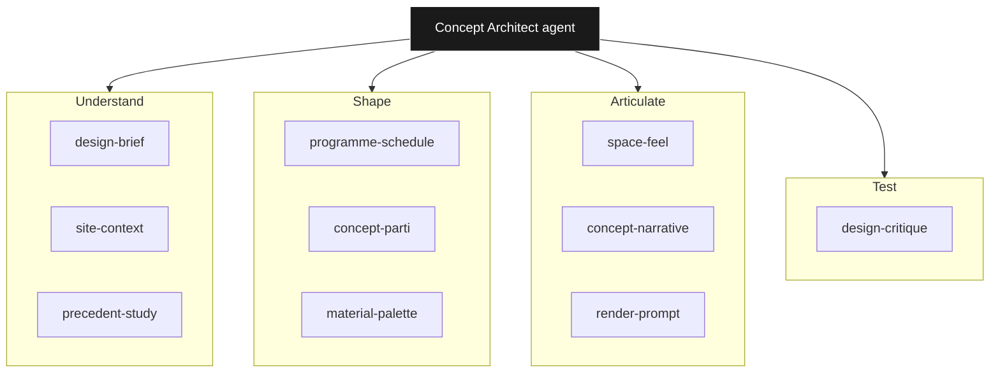

# Architecture Skills

Open-source Claude Code skills for the **concept phase** of architecture.

<!-- skill-count:11 -->
**11 skills. 1 orchestrating agent. 1 plugin.** Built by [Gaia](https://gaia.computer) — the AI that learns your design sense.

---

## What this is

Focused skills for the earliest, most consequential decisions in architecture — the ones that determine what gets built. Briefs, sites, programmes, materials, atmosphere, the organising idea, narratives, renders, precedents, and a critique to test it all.

These skills operate **upstream** — RIBA Stage 0–2 / AIA Pre-Design to Schematic Design, before BIM, before production drawings, before specifications. The concept phase is where the decisions that matter most are made, when they are cheapest to change.

They are built on a specific principle, drawn straight from what architects say goes wrong with AI: **discipline the model, don't just prompt it to write more.** Every skill here shows the basis of its numbers, refuses to fabricate a precedent, a code, or a citation, and flags what needs a professional to verify. A confident, wrong answer is worse than a flagged gap.

## The toolkit



The **concept-architect** agent runs the arc and knows when to stop. The **concept** skill is a quick router when you just want pointing to the right tool.

| Skill | Command | What it does |
|---|---|---|
| Design Brief | `/concept-design:design-brief` | Structure a client conversation or loose notes into a design brief |
| Site Context | `/concept-design:site-context` | Turn supplied site facts into design implications (never invents site data) |
| Programme Schedule | `/concept-design:programme-schedule` | Build/check a schedule of accommodation with net-to-gross — every calculation shown |
| Concept Parti | `/concept-design:concept-parti` | Find the organising idea, as two or three distinct directions |
| Material Palette | `/concept-design:material-palette` | Suggest a cohesive, specifiable material palette |
| Space Feel | `/concept-design:space-feel` | Describe how a space feels — compression, threshold, light, atmosphere |
| Concept Narrative | `/concept-design:concept-narrative` | Write the design argument for a client, jury, or planning board |
| Render Prompt | `/concept-design:render-prompt` | Structured prompts for AI renders — recommends Midjourney + Nano Banana, maps to Gaia Studio presets |
| Precedent Study | `/concept-design:precedent-study` | Build verifiable case studies — flags every attribution, invents nothing |
| Design Critique | `/concept-design:design-critique` | Red-team a scheme against its own stated intent before a pin-up |
| Concept (router) | `/concept-design:concept` | Route a request to the right skill, or show the menu |

### Agent

**Concept Architect** — orchestrates the toolkit. Guides a conversation from vague idea to presentation-ready output, invoking each skill when the work calls for it. Carries the plugin's voice, transparency, and professional-boundary rules.

## Install

```bash
claude plugin marketplace add gaia-computer-technologies/gaia-ai-architect
claude plugin install concept-design@gaia-ai-architect
```

Skills then appear as `/concept-design:<skill>` (e.g. `/concept-design:design-brief`), and Claude will also invoke them automatically when a request matches. Or in Claude Desktop: Settings → Plugins → Add marketplace from GitHub → `gaia-computer-technologies/gaia-ai-architect`.

## Guardrails, by design

Architecture has consequences, and the concept phase is where hopeful, unverifiable claims start. The plugin's governance is not decoration — it loads, and in one case runs:

- **Voice, transparency, and professional-disclaimer rules** ([`plugins/concept-design/rules/`](plugins/concept-design/rules/)) are folded into the agent and every skill: show the basis of a number; say "appears consistent with," never "complies"; never fabricate a precedent or citation.
- **An advisory hook** ([`plugins/concept-design/hooks/`](plugins/concept-design/hooks/)) notices when an output asserts a regulated fact (code, occupancy, ratings, cost, carbon) without a disclaimer, and reminds you. It never blocks; remove `hooks/hooks.json` to disable it.

## Philosophy

**The concept phase is where architecture happens.** What a space feels like, what it's made of, how light enters, what story it tells — decided in the first hours, when a change costs a sketch instead of a site instruction.

We believe in **workflows over wrappers, memory over prompts**, and design intelligence that accumulates across projects. These open-source skills are the part we can share freely. For the full experience, see [Gaia Studio](https://gaia.computer).

## Community

We focus on the concept phase, upstream of BIM. For the rest of the project lifecycle — zoning, specifications, sustainability (EPDs), procurement, due diligence — there is real depth in [Architecture Studio](https://github.com/AlpacaLabsLLC/skills-for-architects) by [ALPA](https://alpa.llc) (Federico Negro), whose work inspired us to open-source ours. The two are complementary: they own downstream, we own upstream. Architecture needs more open tools, and we are all doing this together.

## Contributing

See [CONTRIBUTING.md](CONTRIBUTING.md). Run `bash scripts/lint.sh` before opening a PR — CI runs it on every push.

## License

MIT — [Hermetica Tech B.V.](https://gaia.computer)
